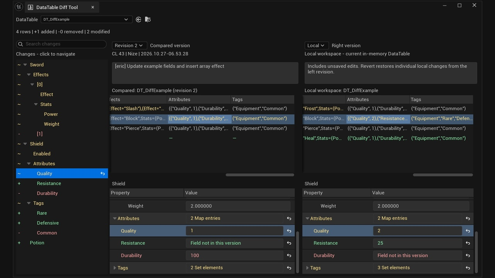

# DataTable Diff Tool

在 Unreal Editor 中并排比较 DataTable 历史版本，按需恢复到本地。

Compare DataTable revisions side by side in Unreal Editor and selectively restore local data.

## 安装与使用

1. 将插件放入 `YourProject/Plugins/DataTableDiffTool/`，确保该目录下包含 `DataTableDiffTool.uplugin`。

2. 使用 UE 5.8 C++ 工具链编译项目的 Editor 目标，重启编辑器并确认插件已启用。内置依赖 `EngineAssetDefinitions` 会自动启用。

3. 连接源代码管理，选择一张已有提交历史的 DataTable。右键选择 **DataTable Diff Tool**，或通过 DataTable 编辑器顶部的 **Diff** 菜单打开。

4. 分别选择左右版本。右侧 **Local** 包含尚未保存的内存修改；两个历史版本互比时只读。

5. 点击变更项或属性旁的恢复箭头，将左侧数据恢复到 Local。支持 **Undo / Redo**；恢复后需手动保存资产。

> 恢复只修改本地内存数据，不执行版本库 revert 或提交。结构或类型不兼容时，相应恢复操作不可用。

### 切换外部比较工具

在 **Editor Preferences → Plugins → DataTable Diff Tool → Revision Comparison Tool** 中选择 **Native External Tool**，并在 **Loading & Saving → Text Diff Tool Path** 设置程序路径。

该设置影响原生版本比较入口；显式的 **DataTable Diff Tool** 命令仍打开本插件。

## Installation and usage

1. Place the plugin in `YourProject/Plugins/DataTableDiffTool/`, with `DataTableDiffTool.uplugin` directly inside that folder.

2. Build your project's Editor target with a UE 5.8 C++ toolchain, restart the editor, and confirm the plugin is enabled. The built-in `EngineAssetDefinitions` dependency is enabled automatically.

3. Connect source control and select a DataTable with revision history. Right-click it and choose **DataTable Diff Tool**, or open the **Diff** menu in the DataTable editor toolbar.

4. Choose a revision on each side. The right-side **Local** includes unsaved in-memory changes. Historical-to-historical comparisons are read-only.

5. Click a reset arrow beside a change or property to restore the left revision's data into Local. **Undo / Redo** is supported. Save the asset to persist your changes.

> Restoring edits local data only; it does not revert or submit files in source control. Incompatible structures or types cannot be restored.

### Using an external diff tool

Under **Editor Preferences → Plugins → DataTable Diff Tool**, set **Revision Comparison Tool** to **Native External Tool**. Configure the executable under **Loading & Saving → Text Diff Tool Path**.

This changes native revision-comparison entry points. The explicit **DataTable Diff Tool** command still opens this plugin.

History uses Unreal's source-control provider interfaces. Perforce has been tested; other providers depend on their history and download support.

## 功能 / Features

- **版本比较 / Revision comparison** — 独立选择两侧版本，查看提交人、时间和说明。Compare revisions with author, date, and description.

- **嵌套数据 / Nested data** — 支持结构体、数组、Map 和 Set；数组插入与删除自动对齐。Inspect structs, arrays, Maps, and Sets with aligned array changes.

- **按项恢复 / Selective restore** — 恢复整行、容器或单个字段，支持撤销与重做。Restore rows, containers, or individual fields with Undo / Redo.

- **同步浏览 / Synchronized navigation** — 搜索变更，同步定位、展开和滚动；只读文本可复制。Search changes and synchronize navigation, expansion, and scrolling; copy read-only values.
